# RetailFlow — Comprehensive UI/UX Design Specification & Figma AI Prompts

> **Mục đích tài liệu:** Tài liệu này mô tả chi tiết toàn bộ 14 màn hình và các Modal/Dialog trong hệ thống **RetailFlow**. Cấu trúc tài liệu được tối ưu hóa đặc biệt để đưa vào **Figma AI (First Draft / Make Designs)** hoặc các AI UI Generator (như Claude, v0, Relume) để tự động sinh wireframe và UI mockup chuẩn xác 100%.

---

## 🎨 1. Design System & Global Tokens

Để AI vẽ đồng bộ xuyên suốt toàn bộ ứng dụng, sử dụng bộ Design Tokens chuẩn sau:

- **Theme Style:** Dark Modern Enterprise Retail & POS Management.
- **Màu nền (Backgrounds):**
  - App Canvas: `#0B0E14` (Deep Charcoal / Pitch Black)
  - Card & Surface: `#121722` (Dark Slate Card)
  - Card Border / Divider: `#1E2638` (Subtle 1px border)
  - Hover / Active State: `#1A2234`
- **Màu thương hiệu (Brand & Accent Colors):**
  - Primary Brand (Manchester United Crimson): `#DC2626` (Red-600) / Active `#B91C1C`
  - Secondary Accent (Tech Blue): `#2563EB` (Blue-600)
  - Success / In-Stock: `#10B981` (Emerald-500)
  - Warning / Low Stock: `#F59E0B` (Amber-500)
  - Danger / Out of Stock: `#EF4444` (Red-500)
- **Typography:**
  - Headings & Logo: `Space Grotesk` hoặc `Plus Jakarta Sans` (Bold 700 / SemiBold 600)
  - Body & Data Tables: `Inter` (Regular 400, Medium 500)
  - Số liệu & Giá tiền: `Inter` hoặc `JetBrains Mono` (Bold 600, tabular numbers)
- **Component Styling:**
  - Border radius: Cards `12px` (`rounded-xl`), Buttons `8px` (`rounded-lg`), Badges `9999px` (`rounded-full`).
  - Input fields: Chiều cao `40px` - `44px`, viền `#1E2638`, nền `#0E121B`, placeholder `#64748B`.
  - Buttons: Primary button có nền đỏ gradient nhẹ hoặc solid `#DC2626`, shadow mờ `0 4px 14px rgba(220,38,38,0.25)`.
- **Global Layout Shell (AppShell):**
  - **Left Sidebar (Width 240px):** Logo "RetailFlow" + biểu tượng ở đỉnh, danh sách menu theo phân quyền, nhãn cửa hàng đang trực (`Store 001`), dưới đáy là User Profile (Avatar, Tên, Chức danh, Nút Logout).
  - **Top Bar (Height 64px):** Breadcrumb dẫn đường, Search bar toàn cục (`Cmd+K`), Chuông thông báo (badge đỏ), Nút chuyển đổi chi nhánh (Store Switcher Dropdown).

---

## 📱 2. Danh Sách Chi Tiết 14 Màn Hình

---

### Màn hình 01: Đăng Nhập (Login Page)
- **Route:** `#/login`
- **Phân quyền:** Khách / Chưa đăng nhập
- **Hình ảnh chụp thực tế:**  
  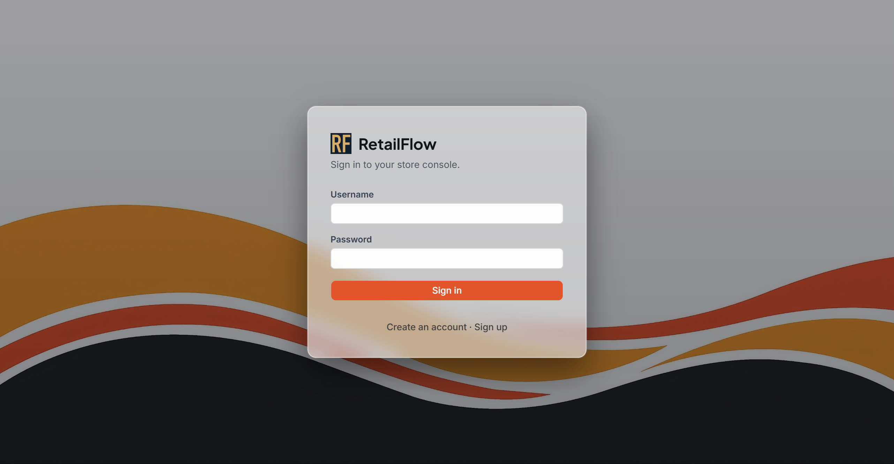

#### Mô tả chi tiết giao diện:
- **Bố cục:** Căn giữa toàn màn hình (Centered Card Layout) trên nền ảnh sân vận động/câu lạc bộ bóng đá có phủ lớp overlay gradient tối `rgba(11, 14, 20, 0.85)`.
- **Card Đăng nhập:** Thiết kế kính mờ (Glassmorphism), viền mảnh phản quang `border border-white/10`, đổ bóng sâu `shadow-2xl`.
- **Thành phần:**
  - Logo thương hiệu tròn 64x64px ở đỉnh card.
  - Tiêu đề: "RetailFlow" (28px Bold) + Mô tả phụ "Hệ thống quản lý chuỗi bán lẻ & quầy thu ngân".
  - Trường nhập `Username` (icon User, placeholder "Nhập tài khoản ví dụ: cashier1, admin1").
  - Trường nhập `Password` (icon Khóa, nút toggle Hiện/Ẩn mật khẩu).
  - Checkbox "Ghi nhớ đăng nhập" & Link "Quên mật khẩu?".
  - Nút Submit: Nền đỏ `#DC2626`, chữ trắng in đậm: "Đăng Nhập".
  - Phía dưới có link dẫn sang trang Đăng Ký: "Chưa có tài khoản? Đăng ký ngay".

> **📋 Prompt cho Figma AI:**  
> *"Design a modern dark-theme enterprise Login page for 'RetailFlow', a retail management platform. Center card with glassmorphism effect (semi-transparent dark background `#121722` with subtle blur and 1px white/10 border). Includes a 64px circular logo, header 'RetailFlow Sign In', username field with user icon, password field with eye icon toggle, remember me checkbox, bold red accent primary button (`#DC2626`), and a link to Sign Up at the bottom. Background is a dimmed cinematic dark stadium backdrop with dark vignette."*

---

### Màn hình 02: Đăng Ký (Sign Up Page)
- **Route:** `#/signup`
- **Phân quyền:** Khách / Đăng ký nhân viên mới
- **Hình ảnh chụp thực tế:**  
  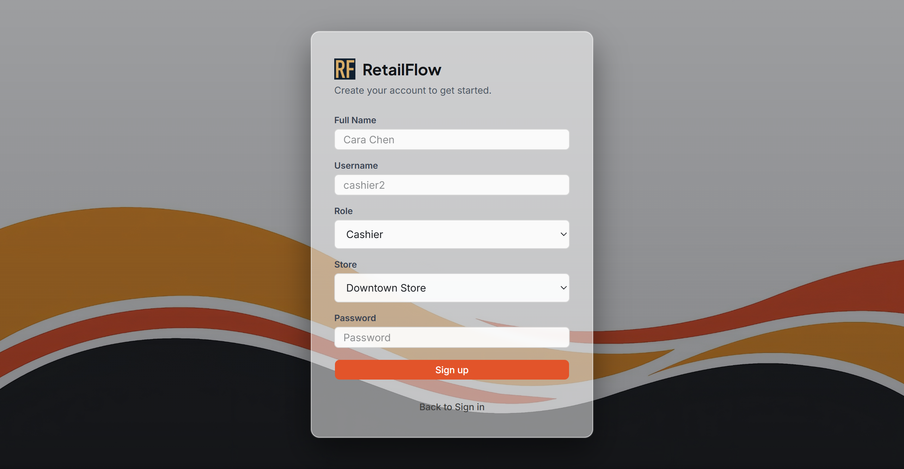

#### Mô tả chi tiết giao diện:
- **Bố cục:** Tương tự trang Login, card căn giữa nhưng rộng hơn (`520px`) để chứa form 2 cột.
- **Thành phần:**
  - Tiêu đề: "Tạo tài khoản mới" + "Đăng ký thành viên hệ thống bán lẻ RetailFlow".
  - Họ và tên đầy đủ (`Full Name`).
  - Tên đăng nhập (`Username`).
  - Vai trò mong muốn (Dropdown: Thu ngân / Quản lý kho / Quản lý cửa hàng).
  - Chi nhánh công tác (Dropdown: Store 001 - Flagship, Store 002 - Downtown).
  - Mật khẩu & Xác nhận mật khẩu.
  - Nút bấm: "Tạo tài khoản" (Màu đỏ `#DC2626`).
  - Link quay lại: "Đã có tài khoản? Đăng nhập ngay".

> **📋 Prompt cho Figma AI:**  
> *"Create a high-fidelity dark glassmorphic Register/Sign-up screen for 'RetailFlow'. Width 520px card centered on a dark wallpaper. Fields include Full Name, Username, Role select dropdown (Cashier, Inventory Staff, Store Manager), Store Location select dropdown, Password, and Confirm Password. Bold red primary CTA button 'Create Account', and secondary link back to Login."*

---

### Màn hình 03: Quầy Thu Ngân / POS (Checkout Terminal)
- **Route:** `#/checkout`
- **Phân quyền:** `CASHIER`, `STORE_MANAGER`
- **Hình ảnh chụp thực tế:**  
  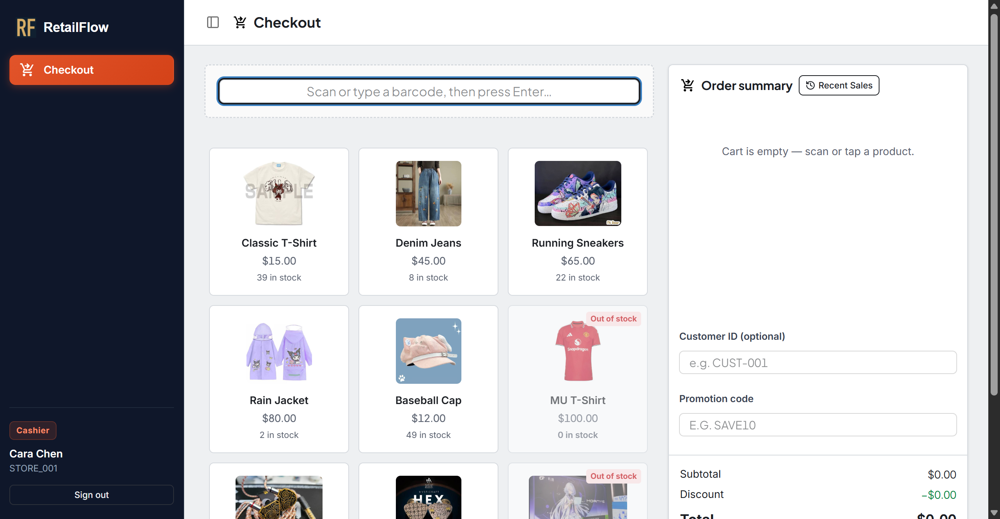

#### Mô tả chi tiết giao diện:
- **Bố cục 2 cột (Split Screen POS):**
  - **Cột Trái (65% chiều rộng): Danh mục sản phẩm & Ô quét mã**
    - Thanh tìm kiếm sản phẩm nhanh + Nút Scan Barcode (icon máy quét).
    - Bộ lọc danh mục dạng tabs: "Tất cả", "Áo thi đấu", "Phụ kiện", "Đồ lưu niệm", "Giày & Bóng".
    - Lưới sản phẩm (Product Grid 3 hoặc 4 cột): Card sản phẩm có hình ảnh sắc nét tỉ lệ 1:1, Tên sản phẩm, Mã SKU, Giá tiền nổi bật màu trắng/đỏ, và Số lượng còn trong kho (Badge xanh "Còn hàng: 24"). Click vào card để thêm vào giỏ.
  - **Cột Phải (35% chiều rộng): Giỏ hàng thanh toán (Cart Panel)**
    - Tiêu đề: "Đơn hàng hiện tại #ORD-0849" + Nút "Xóa giỏ".
    - Danh sách các item đã chọn: Tên sản phẩm, đơn giá, cụm nút tăng/giảm số lượng `[-] 1 [+]`, nút xóa thùng rác.
    - Ô nhập mã giảm giá / Khuyến mãi (Coupon Code) + Nút "Áp dụng".
    - Bảng tổng kết: Tạm tính, Thuế VAT (8%), Chiết khấu khuyến mãi, **Tổng thanh toán (Text to 24px Bold màu đỏ)**.
    - Phương thức thanh toán: 3 nút chọn nhanh (Tiền mặt / Thẻ ngân hàng / QR VNPAY-Momo).
    - Nút CTA lớn toàn chiều rộng: "THANH TOÁN (F9)" màu đỏ nổi bật.
    - Các nút chức năng phụ: "Lưu đơn tạm (F4)", "Xem hóa đơn gần đây".

> **📋 Prompt cho Figma AI:**  
> *"Design a sleek dark-themed Point of Sale (POS) Cashier Terminal for a retail store. Left section (65% width) has a barcode scanner search bar, category pill tabs, and a responsive product grid cards showing item photo, title, SKU, stock count tag, and price. Right section (35% width) is a fixed receipt/cart sidebar with itemized list (qty stepper [-] 1 [+], remove icon), discount coupon input, subtotal, tax, and large bold total amount in red `#DC2626`. Large touch-friendly payment method tabs (Cash, Card, QR Code) and prominent checkout button 'Complete Order (F9)'."*

---

### Màn hình 04: Trang Chủ Điều Hành (Head Office Home / Overview)
- **Route:** `#/home`
- **Phân quyền:** `HEAD_OFFICE_MANAGER`, `SYSTEM_ADMIN`
- **Hình ảnh chụp thực tế:**  
  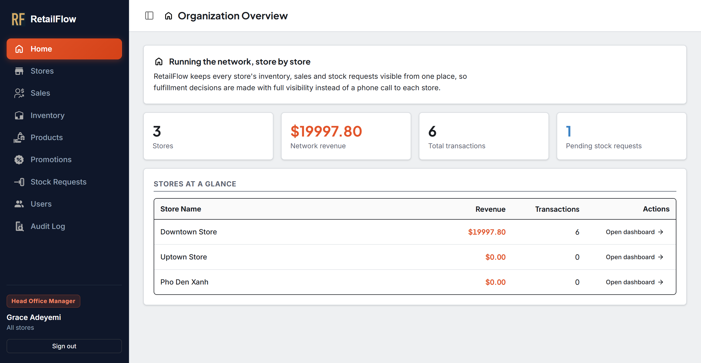

#### Mô tả chi tiết giao diện:
- **Bố cục:** Bảng điều khiển tổng hợp đa chi nhánh.
- **Thành phần:**
  - Header: Lời chào "Xin chào, Giám Đốc Vận Hành" + Bộ lọc thời gian (Hôm nay / Tuần này / Tháng này) + Bộ chọn chi nhánh.
  - **Hàng 4 Thẻ KPI (Bento Metric Cards):**
    1. Tổng doanh thu hệ thống: `$142,500` (Badge tăng trưởng xanh `+12.4%`).
    2. Tổng số đơn hàng: `1,280 đơn` (`+5.1%`).
    3. Cảnh báo tồn kho thấp: `8 sản phẩm` (Badge cam cảnh báo).
    4. Yêu cầu luân chuyển chờ duyệt: `3 phiếu` (Badge xanh dương).
  - **Khu vực biểu đồ trung tâm:**
    - Biểu đồ đường/cột kép so sánh doanh thu giữa các chi nhánh (Store 001 vs Store 002).
    - Biểu đồ tròn cơ cấu doanh thu theo nhóm mặt hàng.
  - **Bảng hoạt động gần nhất:** Top 5 giao dịch lớn nhất và danh sách các phiếu điều chuyển kho đang vận chuyển.

> **📋 Prompt cho Figma AI:**  
> *"Create a high-level Executive Retail HQ Dashboard in dark theme. Top row features 4 stat cards with sparkline mini-charts: Total Revenue ($142,500, +12.4%), Total Orders (1,280), Low Stock Alerts (8 items in amber tag), Pending Stock Requests (3 in blue tag). Middle section shows a dual-axis revenue comparison chart and a category donut chart. Bottom section contains a recent transaction activity table with store tags, status badges, and timestamps."*

---

### Màn hình 05: Báo Cáo Doanh Thu Chi Nhánh (Store Dashboard)
- **Route:** `#/dashboard` & `#/store-detail/:storeId`
- **Phân quyền:** `STORE_MANAGER`, `HEAD_OFFICE_MANAGER`
- **Hình ảnh chụp thực tế:**  
  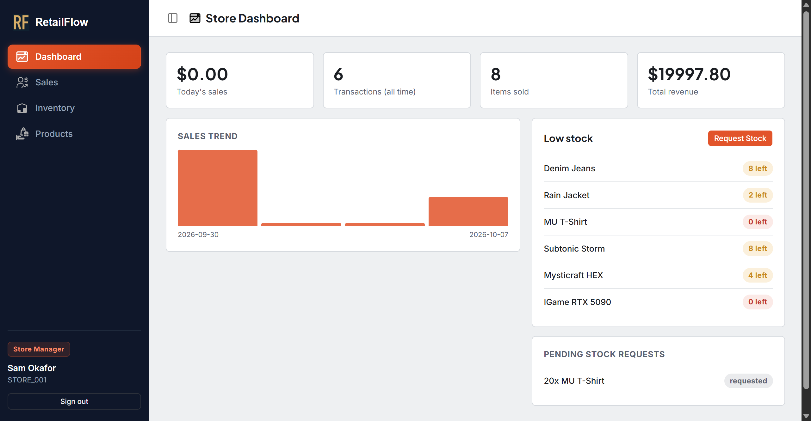

#### Mô tả chi tiết giao diện:
- **Bố cục:** Thống kê chi tiết chuyên sâu cho từng cửa hàng cụ thể.
- **Thành phần:**
  - Banner thông tin cửa hàng: Tên cửa hàng, Địa chỉ, Quản lý phụ trách, Doanh số mục tiêu tháng (Thanh tiến độ Progress bar 78%).
  - Biểu đồ doanh số theo giờ trong ngày (Hourly Peak Hours): Giúp nhận biết khung giờ cao điểm khách đến mua sắm.
  - Top 5 sản phẩm bán chạy nhất chi nhánh (Best Sellers) kèm ảnh thumbnail và doanh số.
  - Hiệu suất nhân viên thu ngân: Doanh thu theo ca của từng nhân viên.

> **📋 Prompt cho Figma AI:**  
> *"Design a Store-Level Performance Dashboard for a single retail branch. Includes a store banner with target progress bar (78%), hourly sales distribution bar chart highlighting peak retail hours, top 5 best-selling merchandise list with thumbnails, and a staff cashier shift leaderboard table with sales volume."*

---

### Màn hình 06: Quản Lý Tồn Kho (Inventory Management)
- **Route:** `#/inventory`
- **Phân quyền:** `INVENTORY_STAFF`, `STORE_MANAGER`, `HEAD_OFFICE_MANAGER`
- **Hình ảnh chụp thực tế:**  
  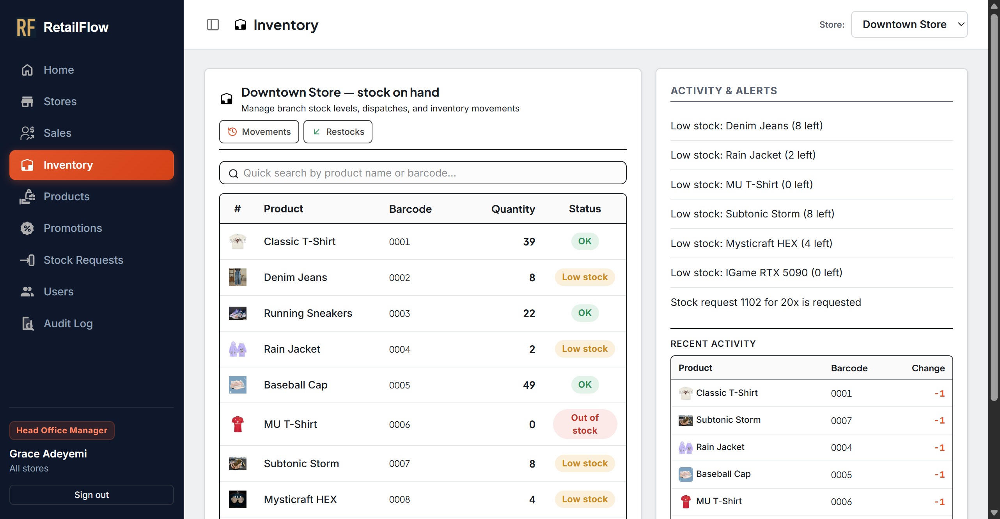

#### Mô tả chi tiết giao diện:
- **Bố cục:** Bảng dữ liệu quản trị kho (Data Grid) kèm các công cụ lọc nhanh.
- **Thành phần:**
  - Thanh Action bar: Ô tìm kiếm tên/mã vạch + Dropdown lọc trạng thái ("Tất cả", "Đủ hàng", "Sắp hết hàng", "Hết hàng") + Dropdown lọc chi nhánh.
  - Các nút hành động chính ở góc trên: Nút "Nhập hàng (Receive Stock)", Nút "Yêu cầu cấp hàng (Request Stock)".
  - **Bảng danh sách tồn kho:**
    - Cột: Ảnh sản phẩm, Tên sản phẩm & SKU, Danh mục, Chi nhánh, Số lượng hiện có (hiển thị số lớn), Ngưỡng tối thiểu (Threshold), Trạng thái (Pill badge: Xanh lá = Bình thường, Cam = Cần nhập, Đỏ = Hết), Nút thao tác (Icon Lịch sử xuất nhập, Icon Điều chỉnh).

> **📋 Prompt cho Figma AI:**  
> *"Design a professional dark-mode Inventory Management table view. Top header with search bar, status filter dropdown (All, In Stock, Low Stock, Out of Stock), Store selector, and two primary action buttons: 'Receive Stock' and 'New Stock Request'. Table columns: Product Thumbnail, Product Name & SKU, Category, Current Quantity, Minimum Safety Threshold, Status Badge (green/orange/red), and Action icons (View Log, Adjust). Clean borders and row hover states."*

---

### Màn hình 07: Quản Lý Sản Phẩm (Products Catalog)
- **Route:** `#/products`
- **Phân quyền:** `HEAD_OFFICE_MANAGER`, `SYSTEM_ADMIN`
- **Hình ảnh chụp thực tế:**  
  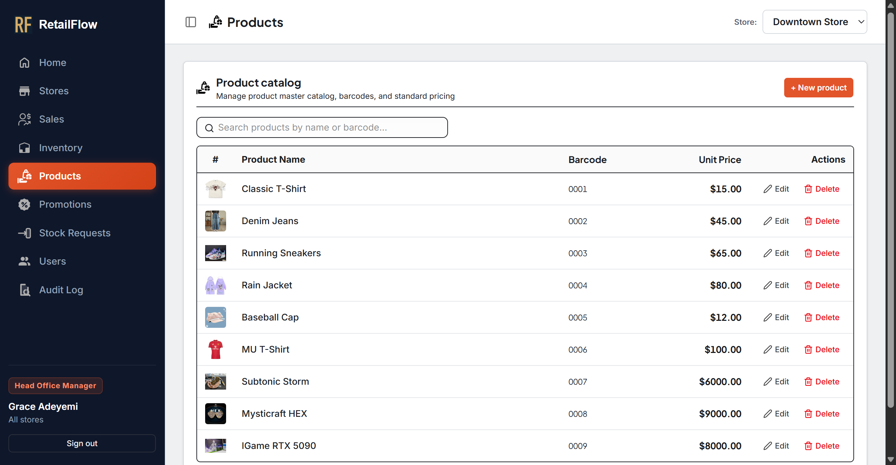

#### Mô tả chi tiết giao diện:
- **Bố cục:** Danh mục sản phẩm trung tâm toàn hệ thống.
- **Thành phần:**
  - Header: Thống kê nhanh "Tổng số 120 sản phẩm đang kinh doanh" + Nút "Thêm sản phẩm mới (+)".
  - Chuyển đổi chế độ xem: Chế độ Dạng Lưới (Grid Cards) hoặc Dạng Bảng (Table List).
  - Bảng chi tiết sản phẩm: Ảnh sản phẩm vuông, Tên thương mại, Barcode chuẩn EAN-13, Giá niêm yết, Giá vốn, Thuế suất, Ngày tạo, Nút Sửa / Xóa.

> **📋 Prompt cho Figma AI:**  
> *"Create a dark modern Product Catalog page for retail. Features total products count, 'Add New Product' red accent button, search and category filters. Grid/Table view toggle. Data rows display image preview, Title, EAN-13 Barcode number, Retail Price, Cost Price, Category tag, and Edit/Delete menu buttons."*

---

### Màn hình 08: Lịch Sử Bán Hàng & Đơn Hàng (Sales History)
- **Route:** `#/sales`
- **Phân quyền:** `CASHIER`, `STORE_MANAGER`, `HEAD_OFFICE_MANAGER`
- **Hình ảnh chụp thực tế:**  
  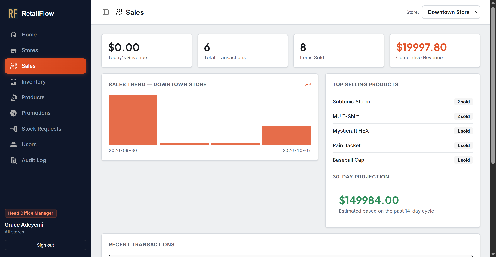

#### Mô tả chi tiết giao diện:
- **Bố cục:** Quản lý hóa đơn và đối soát doanh thu.
- **Thành phần:**
  - Bộ lọc nâng cao: Khoảng ngày (Date Range Picker), Nhân viên thu ngân, Phương thức thanh toán (Cash / Card / QR), Chi nhánh.
  - Nút "Xuất file Excel / CSV".
  - **Bảng danh sách đơn hàng:**
    - Mã đơn (ví dụ `#INV-2026-0042`), Thời gian thanh toán, Chi nhánh, Thu ngân, Số lượng món, Tổng tiền thanh toán, Phương thức thanh toán, Trạng thái (Hoàn thành / Đã hoàn tiền).
    - Cột thao tác: Nút "In lại hóa đơn (Print Receipt)" và "Chi tiết đơn hàng".

> **📋 Prompt cho Figma AI:**  
> *"Design a Sales & Order History log screen in dark SaaS style. Header with Date range picker, Cashier filter, Payment type filter, and 'Export CSV' button. Table lists Order ID, Timestamp, Branch, Cashier Name, Items count, Payment Method badge (Cash/Card/QR), Total Amount, and action button 'Print Receipt'."*

---

### Màn hình 09: Yêu Cầu Cấp Hàng & Điều Chuyển (Stock Requests & Transfers)
- **Route:** `#/stock-requests`
- **Phân quyền:** `INVENTORY_STAFF`, `STORE_MANAGER`, `HEAD_OFFICE_MANAGER`
- **Hình ảnh chụp thực tế:**  
  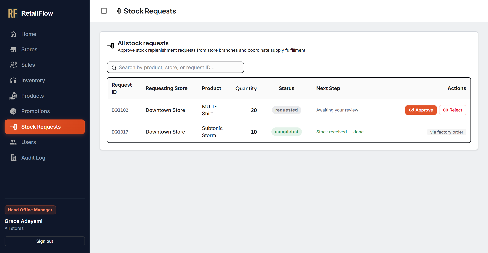

#### Mô tả chi tiết giao diện:
- **Bố cục:** Theo dõi quy trình phê duyệt luân chuyển hàng giữa các kho và từ tổng kho về chi nhánh.
- **Thành phần:**
  - Tab điều hướng: "Chờ phê duyệt (Pending)", "Đang vận chuyển (In Transit)", "Đã hoàn thành (Completed)", "Đã từ chối (Rejected)".
  - Thẻ hoặc dòng phiếu yêu cầu:
    - Mã phiếu (`#REQ-012`), Cửa hàng yêu cầu, Sản phẩm và Số lượng xin cấp, Lý do (Tồn kho chạm ngưỡng), Người tạo.
    - Cụm nút hành động cho Manager: Nút "Duyệt xuất kho (Approve)" màu xanh, Nút "Từ chối (Reject)" màu xám/đỏ.

> **📋 Prompt cho Figma AI:**  
> *"Create a Stock Transfer & Requisition workflow page. Status tabs for Pending, In-Transit, Completed, and Rejected. Cards/table rows display Request ID, Requesting Store, Target Product & Requested Qty, Safety Reason, Created by info. Store Manager controls include green 'Approve & Dispatch' and red 'Reject' action buttons."*

---

### Màn hình 10: Quản Lý Khuyến Mãi (Promotions & Discounts)
- **Route:** `#/promotions`
- **Phân quyền:** `HEAD_OFFICE_MANAGER`, `STORE_MANAGER`
- **Hình ảnh chụp thực tế:**  
  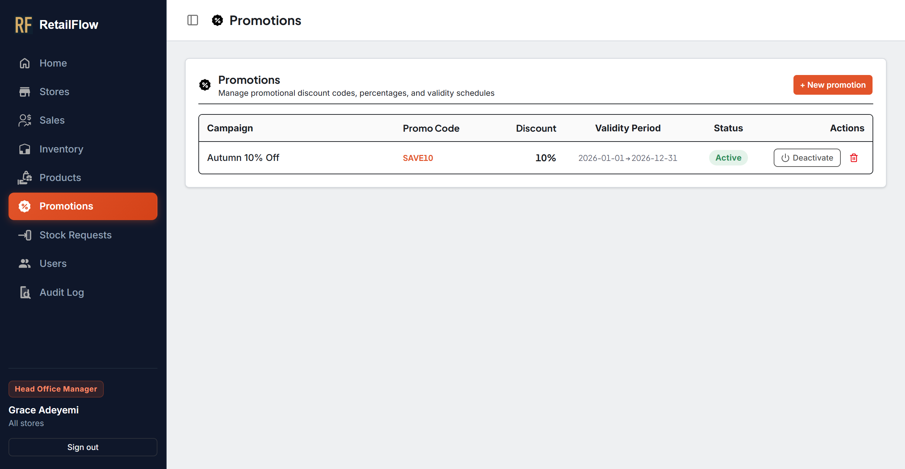

#### Mô tả chi tiết giao diện:
- **Bố cục:** Quản lý chiến dịch giảm giá, mã coupon và combo bán hàng.
- **Thành phần:**
  - Nút "Tạo khuyến mãi mới (+)".
  - Danh sách thẻ khuyến mãi (Promo Cards):
    - Tên chương trình (ví dụ: "Giảm 15% Áo Đấu Sân Nhà Mùa Giải Mới").
    - Mã Code: Badge viền nét đứt có nút copy (`MUFC2026`).
    - Loại: Giảm phần trăm (%) hoặc Giảm tiền trực tiếp ($).
    - Thời gian áp dụng: Từ ngày ... đến ngày ...
    - Trạng thái: Đang chạy (Active - Xanh) / Sắp diễn ra / Hết hạn.
    - Công tắc Toggle Bật/Tắt khuyến mãi ngay lập tức.

> **📋 Prompt cho Figma AI:**  
> *"Design a Promotion & Coupon Management screen in dark theme. 'Create Promotion' CTA button. Grid of promotion cards featuring promo title, dashed coupon code pill with copy button, discount value tag (-15% or -$20), active date range, and a live Toggle switch to activate/deactivate the discount."*

---

### Màn hình 11: Danh Sách Chi Nhánh (Stores Management)
- **Route:** `#/stores`
- **Phân quyền:** `HEAD_OFFICE_MANAGER`, `SYSTEM_ADMIN`
- **Hình ảnh chụp thực tế:**  
  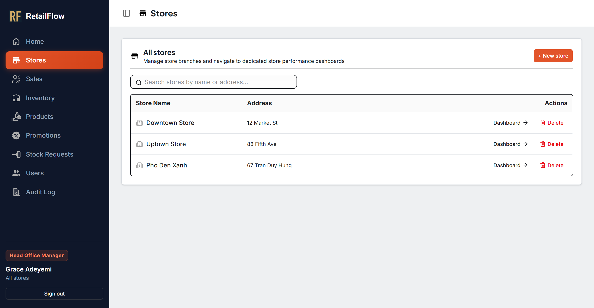

#### Mô tả chi tiết giao diện:
- **Bố cục:** Thẻ danh sách các cửa hàng trong chuỗi bán lẻ.
- **Thành phần:**
  - Header: "Hệ thống chuỗi 5 chi nhánh" + Nút "Thêm chi nhánh mới (+)".
  - Card chi nhánh:
    - Tên chi nhánh (Store 001 - Old Trafford Flagship Store).
    - Địa chỉ kinh doanh, Số điện thoại liên hệ.
    - Quản lý phụ trách chi nhánh (Store Manager).
    - Số lượng nhân viên đang hoạt động.
    - Doanh thu tích lũy trong tháng.
    - Nút "Xem chi tiết kho & doanh số chi nhánh" dẫn sang trang Dashboard của chi nhánh đó.

> **📋 Prompt cho Figma AI:**  
> *"Create a Store Locations Directory page for a retail chain in dark mode. Header with 'Add Store' button. Grid of branch cards displaying store name, physical address, assigned manager name with avatar, active employee count, current month revenue metric, and a 'View Branch Performance' button."*

---

### Màn hình 12: Quản Lý Người Dùng & Nhân Viên (Users Management)
- **Route:** `#/users`
- **Phân quyền:** `SYSTEM_ADMIN`, `HEAD_OFFICE_MANAGER`
- **Hình ảnh chụp thực tế:**  
  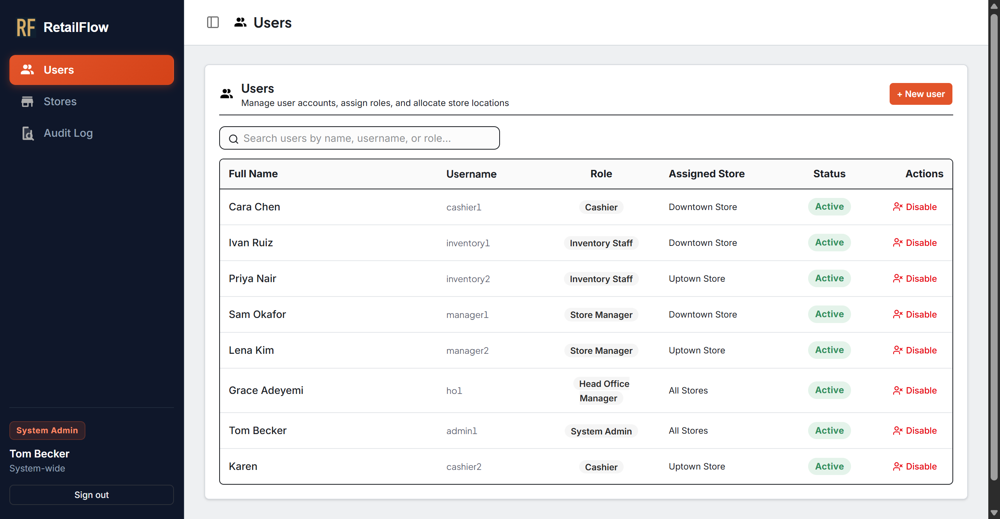

#### Mô tả chi tiết giao diện:
- **Bố cục:** Quản trị danh sách tài khoản toàn bộ nhân sự.
- **Thành phần:**
  - Nút "Tạo tài khoản nhân viên (+)".
  - Bảng danh sách nhân sự:
    - Avatar, Họ tên, Tên đăng nhập (`cashier1`, `manager1`, ...).
    - Vai trò (Badge màu: Đỏ = System Admin, Xanh tím = Head Office, Vàng = Store Manager, Xanh ngọc = Cashier).
    - Cửa hàng trực thuộc.
    - Trạng thái tài khoản: Đang hoạt động (Active) / Đã khóa (Disabled).
    - Thao tác: Sửa thông tin, Đổi mật khẩu, Khóa/Mở khóa tài khoản.

> **📋 Prompt cho Figma AI:**  
> *"Design a User Management & Staff Directory table in dark theme. 'Add New User' button. Table columns: User Avatar & Name, Username handle, Role Badge (Admin, Manager, Cashier, Inventory with distinct colors), Assigned Branch, Status badge (Active/Disabled), and action dropdown (Edit, Reset Password, Disable)."*

---

### Màn hình 13: Phân Quyền & Vai Trò (Roles & Permissions Matrix)
- **Route:** `#/roles`
- **Phân quyền:** `SYSTEM_ADMIN`
- **Hình ảnh chụp thực tế:**  
  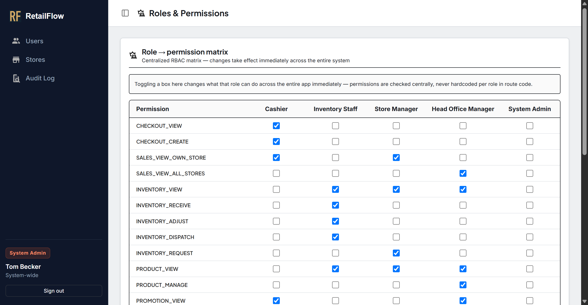

#### Mô tả chi tiết giao diện:
- **Bố cục:** Bảng ma trận ma trận phân quyền (Access Control List / RBAC Matrix).
- **Thành phần:**
  - Danh sách vai trò ở cột bên trái: `SYSTEM_ADMIN`, `HEAD_OFFICE_MANAGER`, `STORE_MANAGER`, `CASHIER`, `INVENTORY_STAFF`.
  - Ma trận các nhóm quyền ở bên phải (dạng bảng checkbox):
    - Nhóm Bán hàng (Checkout View, Checkout Create).
    - Nhóm Kho (Inventory View, Stock Request Create, Receive, Dispatch).
    - Nhóm Báo cáo (Sales View Own Store, Sales View All Stores).
    - Nhóm Cấu hình (Product Manage, User Manage, Role Manage).
  - Nút "Lưu phân quyền (Save Permissions)".

> **📋 Prompt cho Figma AI:**  
> *"Create a clean RBAC (Role-Based Access Control) Permissions Matrix in dark UI. Left pane lists available system roles. Main right table shows categorised permissions (Checkout, Inventory, Analytics, User Management) with interactive toggle checkboxes per permission item and a 'Save Changes' button."*

---

### Màn hình 14: Nhật Ký Hệ Thống / Kiểm Toán (Audit Logs)
- **Route:** `#/audit`
- **Phân quyền:** `SYSTEM_ADMIN`, `HEAD_OFFICE_MANAGER`
- **Hình ảnh chụp thực tế:**  
  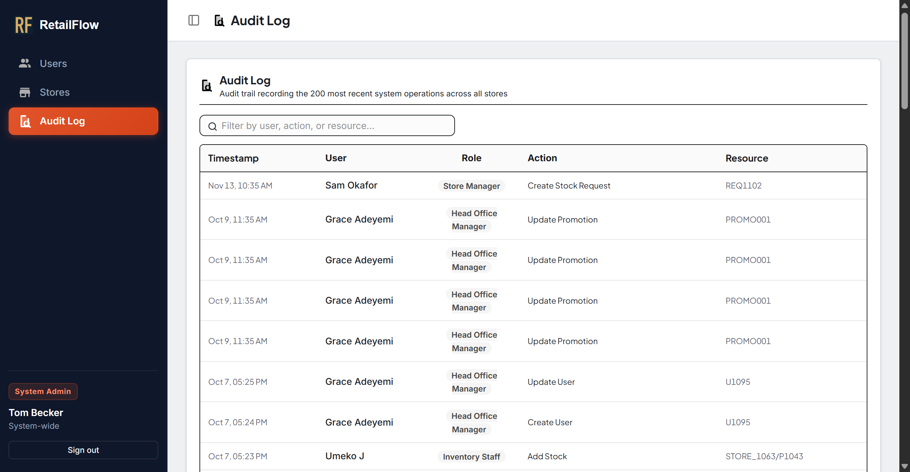

#### Mô tả chi tiết giao diện:
- **Bố cục:** Bảng nhật ký ghi lại mọi hành động nhạy cảm trong hệ thống để bảo mật và chống gian lận.
- **Thành phần:**
  - Bộ lọc: Theo nhân viên, Theo loại hành động (Đăng nhập, Tạo đơn hàng, Đổi giá sản phẩm, Xóa dữ liệu), Theo khoảng ngày.
  - Bảng Audit Log:
    - Thời gian chi tiết (Timestamp chính xác đến giây).
    - Người thực hiện (Username & Role).
    - Hành động (Ví dụ: `UPDATE_PRICE`, `DISPATCH_STOCK`, `DELETE_USER`).
    - Đối tượng tài nguyên (`Product #P004`).
    - Dữ liệu trước và sau thay đổi (Diff: Before vs After).
    - Địa chỉ IP & Thiết bị.

> **📋 Prompt cho Figma AI:**  
> *"Design a Security Audit Logs & System Activity history table in dark enterprise theme. Filters for action type, user, date range. Table columns: Precise Timestamp, Actor Name & Role, Action Tag (colored badge like CREATE, UPDATE, DELETE), Target Resource, Changes Diff view (Before/After JSON values), and IP Address."*

---

## 🧩 3. Danh Sách Các Hộp Thoại (Modals & Dialogs)

Để Figma AI vẽ tiếp các Pop-up Modal xuất hiện trên các trang, sử dụng các mô tả sau:

1. **Hóa đơn in & Thanh toán thành công (Receipt Dialog):**  
   - Bố cục: Modal dạng cuộn giấy in hóa đơn nhiệt trắng/kem nổi bật giữa nền tối.
   - Nội dung: Tên cửa hàng, mã hóa đơn, ngày giờ, danh sách món kèm số lượng và thành tiền, thuế VAT, mã QR tra cứu hóa đơn điện tử, nút "In hóa đơn (Print)" và "Gửi Email cho khách".
2. **Nhập kho / Thêm tồn kho (Add Stock Dialog):**  
   - Chọn sản phẩm, số lượng nhập thêm, đơn vị cung cấp, ghi chú lô hàng, nút xác nhận nhập.
3. **Thêm sản phẩm mới (New Product Dialog):**  
   - Tải ảnh sản phẩm (Drag & Drop upload box), Tên sản phẩm, Mã vạch Barcode, Giá bán lẻ, Danh mục phân loại.
4. **Phê duyệt điều chuyển hàng (Approve Transfer Dialog):**  
   - Hiển thị kho nguồn, kho đích, số lượng yêu cầu, xác nhận số lượng thực xuất và chọn tài xế/đơn vị vận chuyển.

---

## 🚀 4. Hướng Dẫn Nạp Vào Figma AI

1. Mở **Figma** -> Tạo một file thiết kế mới.
2. Bật công cụ **Figma AI** (Tính năng *Make Designs* hoặc phím tắt `Ctrl + K` / `Cmd + K` -> gõ *"Make Design"*).
3. Copy nguyên văn đoạn **📋 Prompt cho Figma AI** của từng màn hình tương ứng ở trên và dán vào thanh prompt của Figma.
4. Figma AI sẽ tự động phân tích cấu trúc cột, bảng màu, typography và tạo ra giao diện vector có thể chỉnh sửa trực tiếp.
